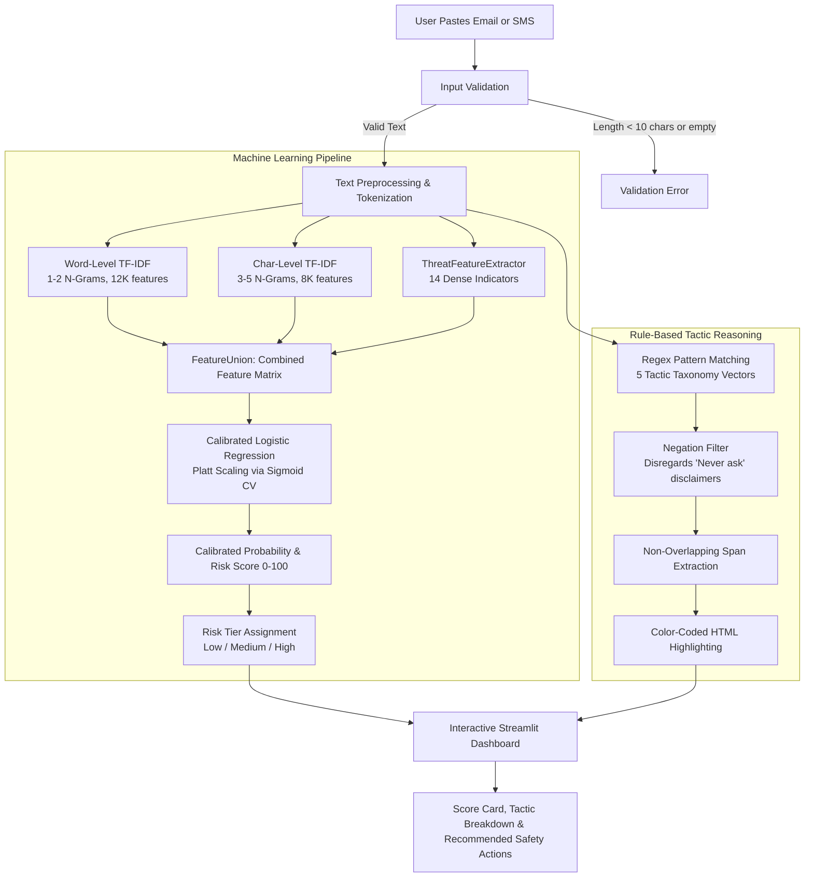

# 🛡️ PhishGuard AI

[](https://www.python.org/)
[](https://streamlit.io/)
[](https://scikit-learn.org/)
[]()
[]()

**PhishGuard AI** is a lightweight, context-aware phishing and social engineering detection application. Built with **Python**, **Streamlit**, and **Scikit-learn**, it inspects emails and SMS messages for deceptive language patterns, psychological coercion, credential harvesting, and Business Email Compromise (BEC) tactics.

Unlike basic keyword scanners, PhishGuard AI pairs a **calibrated multi-view machine learning pipeline** (combining word n-grams, subword character n-grams, and dense threat features) with a **rule-based tactic reasoner** that extracts suspicious phrases, explains the attacker's psychological strategy, and assigns an empirical risk tier (Low, Medium, or High).

---

## 📑 Table of Contents

- [Overview](#-overview)
- [Key Features](#-key-features)
- [How It Works](#-how-it-works)
- [Technology Stack](#-technology-stack)
- [Model & NLP Approach](#-model--nlp-approach)
- [Project Structure](#-project-structure)
- [Installation & Setup](#-installation--setup)
- [How to Use](#-how-to-use)
- [Model Evaluation & Benchmarks](#-model-evaluation--benchmarks)
- [Example Results](#-example-results)
- [Limitations & Responsible Use](#-limitations--responsible-use)
- [Future Improvements](#-future-improvements)
- [Testing](#-testing)
- [Contributing & License](#-contributing--license)

---

## 🔍 Overview

Phishing attacks have evolved far beyond generic spam emails filled with obvious spelling errors. Modern attacks frequently employ:
- **Subtle Business Email Compromise (BEC):** Urgent requests from executives or vendors asking for payroll changes or wire transfers without containing malicious links or attachments.
- **Brand & Authority Impersonation:** Messages that mimic internal IT support, cloud providers, or executive leadership.
- **Psychological Coercion:** Artificial deadlines, account suspension threats, and push fatigue prompts designed to trigger hasty compliance.

**PhishGuard AI** addresses this challenge by providing an accessible, transparent analysis tool that evaluates message text locally, highlights specific manipulation phrases, and explains *why* a message is suspicious.

---

## ✨ Key Features

- **Pasted Email & SMS Analysis:** Inspects raw email text (headers, subjects, bodies) and SMS/smishing messages with input validation (requires at least 10 characters and readable content).
- **Multi-View NLP Feature Extraction:**
  - **Word-Level TF-IDF (12,000 features):** Analyzes domain vocabulary and multi-word phrases.
  - **Character-Level TF-IDF (8,000 features):** Intercepts subword obfuscation and typosquatting (e.g., `micros0ft`, `paypa1`, `sec-urity`).
  - **Dense Behavioral Threat Features (14 dimensions):** Extracts URL threat types, manipulation tactic counts, uppercase ratios, exclamation density, and currency cues.
- **Calibrated Risk Scoring (0–100):** Uses Platt Scaling (`CalibratedClassifierCV` with 5-fold cross-validation) so output probabilities reflect true empirical likelihood rather than arbitrary margin scores.
- **Three-Tier Risk Assessment:**
  - 🟢 **Low Risk (0–34):** Language consistent with benign communications.
  - 🟡 **Medium Risk (35–69):** Borderline phrasing or mixed signals requiring sender verification.
  - 🔴 **High Risk (70–100):** Strong manipulation indicators, credential requests, or coercion.
- **Social Engineering Tactic Detection:** Identifies 5 primary manipulation vectors:
  - ⏳ **Artificial Urgency & Time Pressure:** Tight deadlines (*"within 24 hours"*, *"before payroll cutoff"*, *"act now"*).
  - ⚠️ **Threats, Penalties & Coercion:** Intimidation (*"account suspended"*, *"legal action"*, *"session revoked"*).
  - 🎭 **Authority & Brand Impersonation:** Spoofed roles (*"IT Support"*, *"Chase Security"*, *"IRS"*, *"CEO Request"*).
  - 🔑 **Sensitive Information & Financial Exploitation:** Credential/money requests (*"verify password"*, *"wire transfer"*, *"gift cards"*, *"routing number"*).
  - 📑 **Deceptive Document & E-Sign Lures:** Collaboration baits (*"OneDrive shared document"*, *"DocuSign envelope"*, *"quarantine release"*).
- **Suspicious Phrase Highlighting:** Color-coded HTML inline highlighting that pinpoints exact matched phrases within the original message text.
- **Negation-Aware Matching:** Context-aware regex prevents false alarms on legitimate security disclaimers (e.g., *"We will never ask you to send your password"*).
- **Tailored Safety Recommendations:** Provides prioritized, actionable guidance based on the assigned risk level.
- **1-Click Demo Scenarios:** Preloaded test messages in the web UI for immediate demonstration (IT support lure, CEO gift card BEC, DocuSign lure, and legitimate meeting sync).
- **100% Offline Analysis:** Analyzes messages locally with no external API calls, ensuring privacy and preventing data leakage.

---

## 🔄 How It Works

PhishGuard AI processes an input message through a dual-path pipeline: the machine learning classification engine predicts calibrated risk, while the rule-based reasoner identifies and highlights specific social engineering tactics.



---

## 💻 Technology Stack

| Layer | Technology | Purpose |
|---|---|---|
| **Language** | [Python 3.10+](https://www.python.org/) | Core application language |
| **User Interface** | [Streamlit](https://streamlit.io/) (`>=1.30.0`) | Dark-themed, interactive web dashboard |
| **Machine Learning** | [Scikit-learn](https://scikit-learn.org/) (`>=1.3.0`) | `FeatureUnion`, `TfidfVectorizer`, `LogisticRegression`, `CalibratedClassifierCV` |
| **Data Manipulation** | [Pandas](https://pandas.pydata.org/) (`>=2.0.0`) & [NumPy](https://numpy.org/) (`>=1.24.0`) | Dataset processing, matrix operations, and feature handling |
| **Model Persistence** | [Joblib](https://joblib.readthedocs.io/) (`>=1.3.0`) | Pipeline serialization and metadata storage |
| **Automated Testing** | [Pytest](https://docs.pytest.org/) (`>=7.4.0`) | Unit, integration, and regression test suites |

---

## 🧠 Model & NLP Approach

PhishGuard AI combines statistical machine learning with domain-specific behavioral features:

### 1. Text Preprocessing & Smart Tokenization
Raw text is normalized using [`src/preprocessing.py`](src/preprocessing.py):
- **Subject Normalization:** Strips redundant `Subject:` prefixes.
- **Smart URL Tokenization:** Rather than treating URLs as random strings or stripping them entirely, URLs are categorized into threat-relevant tokens:
  - Raw IP address hosts (e.g., `http://192.168.1.1/login`) $\to$ `ip_address_url_token`
  - Link shorteners (e.g., `bit.ly`, `tinyurl.com`, `t.co`) $\to$ `shortened_url_token`
  - Credential action paths (e.g., `/login`, `?verify`, `/auth`) $\to$ `auth_action_url_token`
  - Standard hyperlinks $\to$ `http_url_token`
- **Entity Masking:** Normalizes email addresses (`email_address_token`), formatted phone numbers (`phone_number_token`), and monetary amounts (`currency_amount_token`).
- **Whitespace & Case:** Removes extraneous line breaks and converts text to lowercase for consistent tokenization.

### 2. Multi-View Feature Extraction
The feature union merges three complementary representations:
1. **Word-Level TF-IDF:** Captures vocabulary and domain phrasing (unigrams and bigrams, up to 12,000 features with sublinear term frequency scaling).
2. **Character-Level TF-IDF:** Extracts character n-grams across word boundaries (3 to 5 characters, up to 8,000 features). This captures intentional typosquatting and subword obfuscation (e.g., replacing letters with digits or hyphens).
3. **Dense Threat Features (`ThreatFeatureExtractor`):** 14 engineered numerical features that quantify structural and behavioral indicators:
   - URL counts (total URLs, presence of raw IP hosts, shorteners, or auth paths)
   - Tactic match counts (urgency, threats, impersonation, sensitive info, deceptive lures, and total detected tactics)
   - Stylistic indicators (exclamation mark count, uppercase character ratio, currency symbol frequency, and normalized log text length)

### 3. Classification & Empirical Probability Calibration
- **Classifier:** L2-regularized `LogisticRegression` with balanced class weights.
- **Calibration (Platt Scaling):** Wrapped in `CalibratedClassifierCV(method='sigmoid', cv=5)`. Standard logistic regression margins or raw SVM distances often produce overconfident probabilities at the extremes. Platt scaling fits a sigmoid mapping on cross-validated holdout folds, ensuring a predicted probability of 0.80 corresponds empirically to an ~80% historical likelihood of phishing.
- **Risk Tiers:**
  - $P(\text{Phish}) < 0.35 \implies$ **Low Risk**
  - $0.35 \le P(\text{Phish}) < 0.70 \implies$ **Medium Risk**
  - $P(\text{Phish}) \ge 0.70 \implies$ **High Risk**

### 4. Rule-Based Tactic Reasoner & Negation Handling
Machine learning scores alone do not explain *why* an email is suspicious. The tactic engine ([`src/tactics.py`](src/tactics.py)) scans for specific social engineering patterns:
- **Taxonomy:** 5 vector definitions with targeted regex patterns.
- **Negation Filtering:** Corporate security reminders frequently state: *"We will never ask you to send your password."* The reasoner inspects the 60-character prefix window preceding sensitive phrase triggers. If preceded by negative assertions (`never`, `won't`, `not ask you to`, etc.), the trigger is ignored to prevent false alarms on authentic security notices.

---

## 📁 Project Structure

```
PhishGuard AI/
├── .streamlit/
│   └── config.toml               # Custom dark cyber UI theme settings
├── data/
│   ├── dataset.csv               # Primary training dataset (10,149 samples, deduplicated)
│   ├── independent_test_set.json # 50 out-of-distribution benchmark cases
│   ├── independent_evaluation_results.json # Metrics from independent 50-sample evaluation
│   ├── fresh_validation_test_set.json      # 30 brand-new validation cases
│   └── fresh_validation_results.json       # Metrics from fresh 30-sample validation
├── models/
│   └── phishguard_model.joblib   # Trained pipeline, calibrated classifier, and metadata
├── scripts/
│   ├── download_data.py          # Script to fetch open-source email/SMS datasets
│   ├── augment_dataset.py        # Dataset enrichment with modern cloud/BEC samples
│   ├── train.py                  # CLI training script with holdout evaluation
│   ├── diagnose.py               # Sanity check runner for sample scenarios
│   ├── evaluate_independent.py   # Benchmark evaluation script (50 unseen samples)
│   └── evaluate_fresh_validation.py # Validation evaluation script (30 unseen samples)
├── src/
│   ├── __init__.py
│   ├── model.py                  # PhishGuardClassifier, training logic, and risk tiering
│   ├── preprocessing.py          # Input validation, text cleaning, and ThreatFeatureExtractor
│   ├── samples.py                # 12 curated demo scenarios for testing and demonstration
│   └── tactics.py                # Tactic definitions, regex matching, and HTML highlighting
├── tests/
│   ├── __init__.py
│   ├── test_e2e_verification.py  # End-to-end subtle phishing verification
│   ├── test_model.py             # Classifier loading, predictions, and calibration tests
│   ├── test_preprocessing.py     # Cleaning, URL tokenization, and feature extractor tests
│   ├── test_regressions.py       # Regression tests for subtle attacks and cloud notices
│   ├── test_samples.py           # Integrity tests for the curated demo sample library
│   └── test_tactics.py           # Tactic regex boundaries, negation filtering, and HTML spans
├── app.py                        # Interactive Streamlit dashboard application
├── requirements.txt              # Production Python package dependencies
├── INDEPENDENT_EVALUATION_REPORT.md # Detailed audit and benchmark report
├── MODEL_IMPROVEMENT_REPORT.md   # Model retraining, tuning, and improvement report
└── README.md                     # Project documentation
```

---

## ⚡ Installation & Setup

### Prerequisites
- **Python 3.10** or higher (tested up to Python 3.13)
- **Git** (optional, for cloning)

### 1. Clone or Open the Repository
```bash
git clone https://github.com/your-username/PhishGuard-AI.git
cd PhishGuard-AI
```

### 2. Create and Activate a Virtual Environment

**On Windows (PowerShell):**
```powershell
python -m venv venv
.\venv\Scripts\Activate.ps1
```

**On Windows (Command Prompt):**
```cmd
python -m venv venv
venv\Scripts\activate.bat
```

**On macOS / Linux:**
```bash
python3 -m venv venv
source venv/bin/activate
```

### 3. Install Dependencies
```bash
pip install -r requirements.txt
```

### 4. Launch the Streamlit Web Application
```bash
streamlit run app.py
```
After starting, open your web browser to:
```
http://localhost:8501
```

---

## 🚀 How to Use

1. **Select a Demo Scenario (Optional):**
   Click any of the quick scenario buttons at the top:
   - 🚨 **IT Support Urgent** (Account suspension phish)
   - 💳 **CEO Gift Card (BEC)** (Executive impersonation spear-phish)
   - 📄 **DocuSign Contract** (Deceptive e-signature lure)
   - ✅ **Legitimate Meeting** (Authentic workplace communication)
2. **Or Paste Your Own Message:**
   Paste an email (including subject and body) or an SMS text into the main text area.
3. **Click "⚡ Analyze Message":**
   The application validates the input and runs offline feature extraction and inference.
4. **Review the Results:**
   - **Risk Score Card:** View the overall risk tier (Low, Medium, High), risk index (0–100), and classification summary.
   - **Suspicious Phrase Inspection:** Review your original message with color-coded highlights showing detected triggers.
   - **Detected Tactics:** Expand detected manipulation categories to understand the attacker's psychological strategy.
   - **Recommended Actions:** Follow the tailored steps (e.g., verifying via official channels, avoiding links, or confirming routine hygiene).
5. **Clear:** Click **"🗑️ Clear"** to reset the input area.

---

## 📊 Model Evaluation & Benchmarks

The model was evaluated across three distinct evaluation tiers: the **training holdout test set**, an **independent out-of-distribution benchmark** (50 unseen samples), and a **fresh validation benchmark** (30 unseen samples).

> [!NOTE]
> **Important Evaluation Context:** The independent and fresh validation sets are small, curated benchmarks designed to measure specific failure modes (e.g., modern BEC, MFA push fatigue, SaaS billing). They reflect performance on these specific challenge scenarios and are not guarantees of real-world performance on arbitrary incoming emails.

### 1. Training Holdout Test Set Performance
Evaluated on an untouched 20% holdout split from `data/dataset.csv` (10,149 total deduplicated samples, 2,030 test samples):

| Metric | Score | Interpretation |
|---|:---:|---|
| **Accuracy** | **96.85%** | Overall correct classifications across holdout split |
| **Precision** | **93.21%** | True phishing / Total flagged phishing |
| **Recall (Sensitivity)** | **91.92%** | Proportion of actual phishing messages detected |
| **F1-Score** | **92.56%** | Harmonic mean of precision and recall |
| **Specificity** | **98.18%** | Proportion of legitimate messages correctly cleared |
| **False Positive Rate (FPR)** | **1.82%** | 29 false alarms out of 1,597 legitimate test samples |
| **False Negative Rate (FNR)** | **8.08%** | 35 missed attacks out of 433 phishing test samples |
| **ROC-AUC** | **0.9928** | Overall discriminative power across decision thresholds |

**Holdout Confusion Matrix (N = 2,030):**
```
                  Predicted Legit    Predicted Phish
  Actual Legit    1,568 (TN)             29 (FP)
  Actual Phish       35 (FN)            398 (TP)
```

---

### 2. Independent Out-of-Distribution Benchmark (N = 50)
Evaluated via [`scripts/evaluate_independent.py`](scripts/evaluate_independent.py) across 50 unseen modern emails and SMS messages (25 Phishing, 25 Legitimate; 0 overlap with training data):

| Metric | Score | Value |
|---|:---:|---|
| **Accuracy** | **96.00%** | 48 / 50 samples correctly classified |
| **Precision** | **92.59%** | 25 True Positives / 27 Predicted Phishing |
| **Recall (Detection Rate)** | **100.00%** | 25 / 25 Attacks Detected (0 missed attacks) |
| **F1-Score** | **96.15%** | Harmonic mean |
| **Specificity** | **92.00%** | 23 / 25 Legitimate messages correctly cleared |
| **False Positive Rate (FPR)** | **8.00%** | 2 / 25 Legitimate messages flagged |
| **False Negative Rate (FNR)** | **0.00%** | 0 / 25 Attacks missed |
| **ROC-AUC** | **1.0000** | Full area under ROC curve |

**Independent Confusion Matrix (N = 50):**
```
                  Predicted Legit    Predicted Phish
  Actual Legit       23 (TN)              2 (FP)
  Actual Phish        0 (FN)             25 (TP)
```

**Category Breakdown (Independent Benchmark):**
- **Contemporary Smishing & Lures:** 5/5 (100.0%) correct
- **MFA Fatigue & Push Bombing:** 5/5 (100.0%) correct
- **Paraphrased Phishing:** 5/5 (100.0%) correct
- **Payment Diversion:** 5/5 (100.0%) correct
- **Subtle BEC:** 5/5 (100.0%) correct
- **Legitimate Billing & Finance:** 6/6 (100.0%) correct
- **Legitimate Collaboration:** 6/6 (100.0%) correct
- **Legitimate Operations & IT:** 6/6 (100.0%) correct
- **Legitimate Security Alerts:** 5/7 (71.4%) correct *(2 borderline false positives: automated GitHub PAT creation and Google 2-Step status notices)*

---

### 3. Fresh Out-of-Distribution Validation Set (N = 30)
Evaluated via [`scripts/evaluate_fresh_validation.py`](scripts/evaluate_fresh_validation.py) across 30 brand-new, unseen challenge samples (15 Phishing, 15 Legitimate; 0 overlap):

| Metric | Score | Value |
|---|:---:|---|
| **Accuracy** | **90.00%** | 27 / 30 samples correctly classified |
| **Precision** | **83.33%** | 15 / 18 Predicted Phishing |
| **Recall (Detection Rate)** | **100.00%** | 15 / 15 Attacks Detected (0 missed attacks) |
| **F1-Score** | **90.91%** | Harmonic mean |
| **Specificity** | **80.00%** | 12 / 15 Legitimate messages cleared |
| **False Positive Rate (FPR)** | **20.00%** | 3 / 15 Legitimate messages flagged |
| **False Negative Rate (FNR)** | **0.00%** | 0 / 15 Attacks missed |
| **ROC-AUC** | **1.0000** | Full area under ROC curve |

**Fresh Validation Confusion Matrix (N = 30):**
```
                  Predicted Legit    Predicted Phish
  Actual Legit       12 (TN)              3 (FP)
  Actual Phish        0 (FN)             15 (TP)
```

---

## 🧪 Example Results

Below are verified results produced by the current trained model on representative messages from the curated demo library ([`src/samples.py`](src/samples.py)):

### Example 1: Obvious Phishing — Impersonated IT Support
- **Input Excerpt:** *"Our IT Department detected multiple unauthorized access attempts... your account will be suspended within 24 hours unless you verify your identity... click below to verify your password..."*
- **Predicted Class:** Phishing / Social Engineering
- **Risk Level:** **High Risk** (Score: 100/100)
- **Detected Tactics:**
  - ⏳ Artificial Urgency & Time Pressure (*"within 24 hours"*, *"act now"*, *"immediately"*)
  - ⚠️ Threats, Penalties & Coercion (*"account will be suspended"*, *"unauthorized access"*)
  - 🎭 Authority & Brand Impersonation (*"it department"*, *"global it security team"*)
  - 🔑 Sensitive Information Exploitation (*"verify your identity"*, *"verify your password"*)
- **Status:** ✅ Correctly Intercepted

### Example 2: Subtle Phishing — Executive Gift Card Request (BEC)
- **Input Excerpt:** *"Are you at your desk right now? I need you to purchase 5 Apple gift cards of $100 each for a client gift presentation right away. Do not call me as I am in a board meeting... submit expense reimbursement..."*
- **Predicted Class:** Phishing / Social Engineering
- **Risk Level:** **High Risk** (Score: 88/100)
- **Detected Tactics:**
  - ⏳ Artificial Urgency & Time Pressure (*"right away"*)
  - 🎭 Authority & Brand Impersonation (*"are you at your desk right now"*, *"do not call me"*)
  - 🔑 Sensitive Information & Financial Exploitation (*"purchase 5 apple gift cards"*, *"expense reimbursement"*)
- **Status:** ✅ Correctly Intercepted

### Example 3: Legitimate Communication — Corporate Meeting Sync
- **Input Excerpt:** *"Hi Team, Thank you everyone for attending this morning's sprint planning session. Attached are the meeting minutes and roadmap for Q3... Next weekly sync will be on Thursday..."*
- **Predicted Class:** Legitimate Communication
- **Risk Level:** **Low Risk** (Score: 1/100)
- **Detected Tactics:** None
- **Status:** ✅ Correctly Cleared

### Example 4: Dual-Use Security Alert — Password Reset Request
- **Input Excerpt:** *"We received a request to reset the password associated with this email address. If you made this request, please follow the link below to set a new password: https://auth.company-domain.com/account/reset?token=abc88921..."*
- **Predicted Class:** Phishing / Social Engineering
- **Risk Level:** **High Risk** (Score: 90/100)
- **Detected Tactics:** None
- **Status:** ⚠️ False Positive / High Suspicion (Illustrates the dual-use nature of authentic password reset links sharing vocabulary with credential harvesters).

---

## ⚠️ Limitations & Responsible Use

> **CRITICAL DISCLAIMER:** PhishGuard AI is an **educational and research prototype**. It is **not** an enterprise-grade email security gateway (such as Proofpoint, Microsoft Defender, or Mimecast) and should never be used as the sole line of defense.

1. **Text-Only Scope:** PhishGuard AI analyzes the linguistic text content of an email or SMS. It does **not** inspect authoritative DNS records, cryptographic signatures (SPF, DKIM, DMARC), email routing hops, or SSL certificates.
2. **No Dynamic URL Sandboxing:** PhishGuard AI categorizes URLs by regex patterns (e.g., shorteners, IPs, auth paths). It does **not** follow HTTP redirects, execute JavaScript, or scan destination landing pages for malware.
3. **Dual-Use Authentication Notices (False Positives):** Genuine automated security notifications (e.g., password reset requests, personal access token generation, 2FA confirmations) often contain phrases identical to phishing lures (`reset password`, `verify identity`, `new token`). These can occasionally receive elevated suspicion scores.
4. **Multi-Stage & Conversational Attacks:** Sophisticated spear-phishing campaigns where an adversary builds rapport across multiple benign messages before requesting an action cannot be detected from a single isolated message.
5. **Human Out-of-Band Verification Required:** Any message requesting financial changes (wire transfers, bank routing changes, gift cards) or credential resets must always be verified via an independent, trusted channel (e.g., calling the sender on a known phone number).

---

## 🔮 Future Improvements

Realistic next steps for the project include:

- [ ] **Email Header & Cryptographic Inspection:** Add an optional header parser to verify SPF, DKIM, and DMARC alignment alongside text classification.
- [ ] **Live URL Threat Intelligence:** Integrate with safe lookup APIs (e.g., Google Safe Browsing or VirusTotal) or HTTP redirect unshorteners.
- [ ] **Local LLM Explanation Engine:** Incorporate an offline Small Language Model (SLM) to generate personalized, conversational threat explanations.
- [ ] **Client Extensions:** Develop a lightweight browser extension or email client add-in (for Gmail/Outlook) to enable 1-click analysis.
- [ ] **Continuous Feedback Loop:** Implement an optional feedback mechanism for users to submit misclassified messages to a review queue for future dataset iterations.

---

## 🧪 Testing

The repository contains an automated test suite with **43 unit, integration, and regression tests** built with `pytest`.

### Running Tests
Execute the test suite from the project root:
```bash
python -m pytest -v
```

### Verified Test Suite Summary
```
============================= test session starts =============================
platform win32 -- Python 3.13.5, pytest-8.4.2
collected 43 items

tests/test_e2e_verification.py ..                                        [  4%]
tests/test_model.py ........                                             [ 23%]
tests/test_preprocessing.py .........                                    [ 44%]
tests/test_regressions.py ........                                       [ 62%]
tests/test_samples.py ..                                                 [ 67%]
tests/test_tactics.py ..............                                     [100%]

============================= 43 passed in 8.60s ==============================
```

**Coverage Breakdown:**
- `test_e2e_verification.py`: End-to-end subtle phishing detection and sample library tests.
- `test_model.py`: Model loading, input validation, risk tier mapping, probability calibration, and error handling.
- `test_preprocessing.py`: Text sanitization, smart URL classification tokens, and `ThreatFeatureExtractor` dimensions.
- `test_regressions.py`: Regression coverage for modern cloud alerts, SaaS billing, and subtle BEC attacks.
- `test_samples.py`: Schema and non-emptiness verification for all curated demo messages.
- `test_tactics.py`: Pattern matching, negation prefix filtering, and non-overlapping HTML span generation.

---

## 🤝 Contributing & License

### Contributing
Contributions to improve detection accuracy, expand legitimate test benchmarks, or refine the user interface are welcome:
1. Fork the repository.
2. Create a feature branch (`git checkout -b feature/new-tactic-rule`).
3. Commit your changes and ensure all tests pass (`python -m pytest`).
4. Submit a Pull Request with a clear description of your modifications.

### License
**No license has been specified** for this repository yet. All rights are reserved by the original author until an open-source license (such as MIT or Apache 2.0) is formally added.
